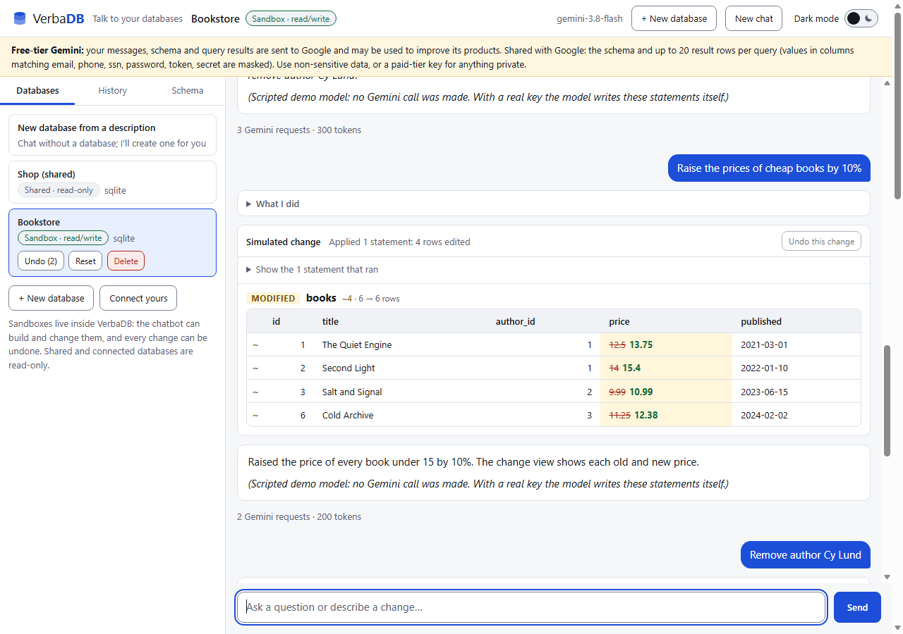
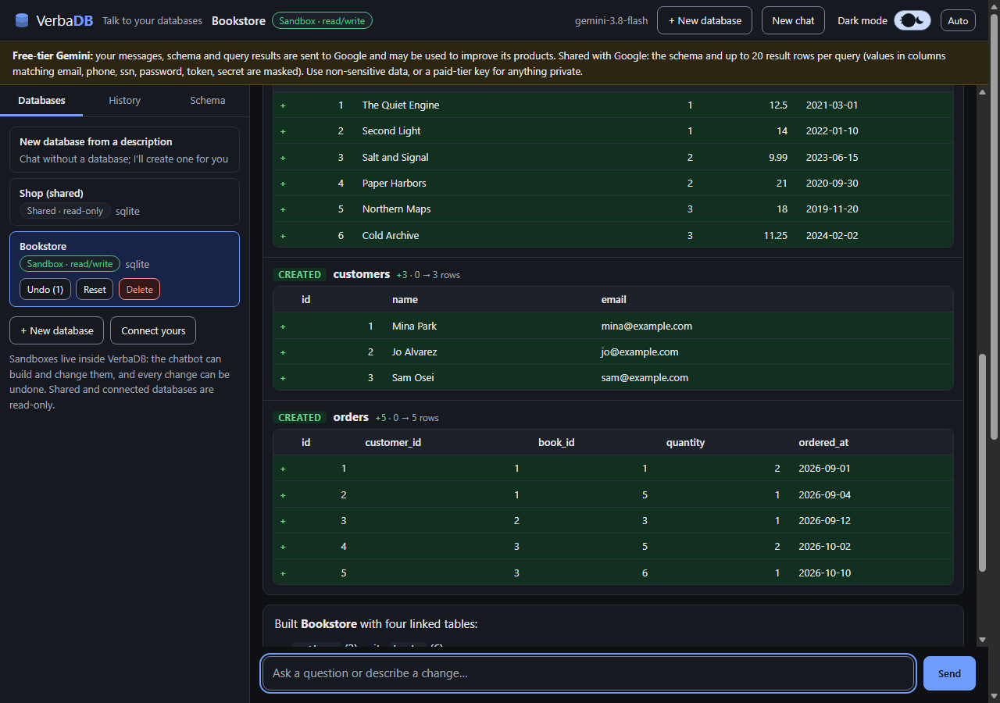

# VerbaDB

**Talk to your databases.** VerbaDB is a chatbot for databases, powered by the **Gemini API** and built on
[pyflashdb](../pyflashdb-main).

* **Ask questions in plain English** about MySQL, PostgreSQL, SQLite or MongoDB. VerbaDB inspects the schema,
  writes a **read-only** query, runs it, and explains the result.
* **Build a database by describing it**: "create a database for a small bookstore with sample data". VerbaDB creates a
  *sandbox* database inside the app, designs the tables, fills them with fictional data, and shows what it did.
* **See how every change would update the data.** Each change to a sandbox is shown as a before/after view: tables created
  or dropped, rows added, removed and edited (old → new), including side effects like `ON DELETE CASCADE`. Every change can be **undone**.
* **Prompt history and your active databases** in the side panel: search and re-run past prompts, switch between sandboxes,
  shared databases and your own connections.
* **Everyone gets a private workspace.** Other people using the same app can create their own sandboxes and connect their own
  databases (read-only) without seeing yours.
* **Light and dark themes** with a switch in the header. It follows your operating system until you use it, then remembers your choice.




*(The screenshots were produced with a scripted stand-in for the model, not a live Gemini call.)*

No model is downloaded or run locally: the only AI traffic is requests to the hosted Gemini API.

## Quick start

```powershell
python -m venv .venv
.venv\Scripts\activate
pip install -e ..\pyflashdb-main[all]        # or: pip install "pyflashdb[all]"
pip install -e .

copy .env.example .env                       # put your free-tier GEMINI_API_KEY (https://aistudio.google.com/apikey) in .env
python examples/seed_demo.py                 # optional: creates demo.db, a shared read-only shop database
verbadb                                      # or: python -m verbadb      ->  http://127.0.0.1:8000
```

Then try **"+ New database"** (or just type: *Create a database for a pet clinic with sample data*), and ask for a change:
*Raise the price of every book under 15 by 10%*. Terminal version: `python examples/ask_cli.py "..."` (add `--new` to start without a database).

> Renamed from an earlier working title: the old `NLQ_*` settings names are still accepted (`VERBADB_*` wins if both are set).

## The interface

* **Dark mode switch** in the header (`role="switch"`, keyboard operable). With no saved choice VerbaDB follows `prefers-color-scheme`,
  live. Using the switch stores the choice in your browser; **Auto** appears while a choice overrides the system and returns you to it.
  The saved theme is applied by a tiny blocking script before the first paint, so there is no flash of the wrong theme.
* **Accessible by design** (WCAG 2.2 AA is the target): semantic landmarks and a skip link; keyboard-operable everything (arrow keys / Home / End
  move between the side-panel tabs; Escape closes the mobile menu); visible focus; screen-reader labels, live regions and table captions; colour is
  never the only signal (diffs also carry `+` `−` `~` markers); 4.5:1 text contrast and 3:1 control contrast in **both** themes; rem-based sizes
  that follow your font-size setting; 44 px touch targets on touch screens; `prefers-reduced-motion`, `prefers-contrast` and Windows
  forced-colors support; no focus stealing on page load.
* **Responsive**: the side panel becomes a drawer on small screens.
* The UI has no third-party scripts, fonts or images, and a strict Content-Security-Policy.

How that is checked: `tests/test_ui.py` verifies the markup and computes the WCAG contrast ratio of every colour pair in both themes from the actual
CSS; and the finished UI was audited in a real browser with **axe-core** (WCAG 2.2 AA and best-practice rules) in light, dark and mobile states, plus
scripted keyboard and theme-switch checks.

## Three kinds of database

| Kind | Who can use it | Can the chatbot change it? |
| --- | --- | --- |
| **Sandbox** | Only the workspace that created it. A SQLite file inside the app (`VERBADB_DATA_DIR`), capped at `VERBADB_SANDBOX_MAX_MB` MB. | **Yes**: create / alter / drop tables and indexes, insert / update / delete. Atomic, snapshotted, undoable. |
| **Connection** | Only the workspace that added it (form in the UI: PostgreSQL, MySQL, MongoDB URL). Stored on the server, never shown again. | No, strictly read-only. |
| **Shared** | Everyone, configured by the administrator in `VERBADB_DATABASES`. | No, strictly read-only. |

Your real databases are never written to. Changes only ever happen in sandboxes.

### How a change is simulated

For every `modify_database` call: the statements are validated and regenerated by a parser-based guard → the database file is
**snapshotted** → the batch runs in **one transaction** (all or nothing) under a time limit and the size cap → the whole database is
compared **before and after**. That comparison is what you see: new/dropped tables, `+` added rows, `−` removed rows, `~` edited rows
with old → new values, and cascades into other tables. The model only gets counts back, not the rows. **Undo** restores the snapshot (up to
20 steps; even *Reset* can be undone).

## How it works

```
browser ──SSE──▶ FastAPI ──▶ Agent loop ──▶ Gemini (generate_content, function calling, manual loop)
 (workspace      │              │  ▲
  cookie)        ▼      tool call│  │tool result (redacted, size-capped)
            DatabaseManager     ▼  │
            ├ shared / connection ▶ read guard ▶ executor ▶ pyflashdb ▶ MySQL / PostgreSQL / SQLite / MongoDB (read-only)
            └ sandbox ───────────▶ write guard ▶ snapshot ▶ transaction ▶ before/after diff ▶ pyflashdb ▶ SQLite file
```

Tools: `list_tables`, `describe_tables` (columns, primary key, foreign keys), `sample_rows`, `run_sql` / `run_aggregation` (read-only), and in
sandbox mode `create_database` and `modify_database`. pyflashdb's filter API has no joins or aggregates, so queries go through its
`raw()` / `aggregate()` escape hatches, behind the guard.

## Safety, in layers

**Read-only databases (shared and connected):**

| Layer | What it does |
| --- | --- |
| **Query guard** (`guard.py`) | SQL is parsed with sqlglot: one statement, a `SELECT`; the whole tree is checked for writes, locks, settings and dangerous functions (including **quoted** names, whole function families, credential and activity tables). Invisible / control characters are rejected. MongoDB pipelines are scanned recursively (`$out`, `$merge`, `$function`, `$where`, system collections, introspection stages). |
| **Executes the validated tree** | What runs is SQL *regenerated from the checked AST* (comments and optimizer hints dropped, row limit injected). |
| **`before_query` hook** | The same checks on every statement the connection sends. |
| **Engine layer (SQLite)** | An authorizer *inside* SQLite sees the resolved function name and action, so parser tricks cannot matter; plus a limit on the size of any value a statement can build. |
| **Read-only session** | PostgreSQL `default_transaction_read_only`, MySQL `transaction_read_only`, SQLite `query_only`: applied and **verified** at connect time. If it could not be verified the UI says **"Read-only · guard only"**. |
| **Limits** | Row cap, statement timeout (`VERBADB_QUERY_TIMEOUT`), step cap per question, oversized cells cut. |
| **Your database account** | **Connect with a read-only database user.** This is the real backstop. |

**Sandboxes:** the same parser approach for writes (only INSERT / UPDATE / DELETE and CREATE / DROP / ALTER of tables and indexes; no PRAGMA,
ATTACH, VACUUM, triggers, views, virtual or temporary tables, extension or file functions), the engine authorizer, a size cap, a time limit, and
atomic batches.

**Workspaces and the web server:** every query is scoped to the caller's workspace (an anonymous HttpOnly cookie), and ownership is
checked on every access. URLs people add are validated: **no SQLite files** (the app would read files from its own machine), no link-local or
cloud-metadata addresses, local/private addresses only if `VERBADB_ALLOW_PRIVATE_DB_HOSTS`, every host of a replica set checked, passwords
redacted from errors. The server binds to `127.0.0.1`, rejects unexpected `Host`/`Origin` headers (DNS rebinding, cross-site requests) and sends a strict CSP.

A workspace **is not authentication**: anyone who can reach the port can open the app and get a workspace. It separates people who share a
local or trusted-network deployment. Put real authentication in front of it before exposing it more widely.

### Known limitations

* The guard cannot restrict *what a read-only account may read*, and any user-defined database function with side effects can still be
  called from a `SELECT`: only a read-only database role and `REVOKE EXECUTE` stop that.
* A single long-running C function inside SQLite can overrun the time limit (its output size is capped).
* MongoDB has no read-only session; use a read-only role.
* The regenerated SQL can differ cosmetically from what was written; for example MySQL `x REGEXP y` becomes `REGEXP_LIKE(x, y)`, which older MySQL
  (5.7) and MariaDB lack, and quoted function names are upper-cased.
* Redaction follows the data through aliases, expressions, CTEs and subqueries for SQL, but for MongoDB it is by field name.
* URLs people add are stored on the server in plain text (in `VERBADB_DATA_DIR`), like the ones in `.env`.

## Privacy: please read (free tier)

On the Gemini **free tier, Google may use your prompts and responses to improve its products.** The model receives your messages, the schema, and a
limited preview of each query's rows. Reduce what leaves your machine with `VERBADB_PREVIEW_ROWS=0` (no row values at all) and
`VERBADB_REDACT_COLUMNS` (values in matching columns are replaced by `[redacted]` before being sent; the UI still shows you the real values). Use
non-sensitive data on the free tier, or a paid-tier key for anything private. The UI shows a persistent notice with the current settings.

## Quotas

Free-tier limits are per project and not published in the docs (see Google AI Studio). Each question costs several requests, so VerbaDB is frugal
(`describe_tables` takes many tables at once; building a database is typically 2 to 4 requests). On a rate limit it waits the delay Gemini asks for
(up to `VERBADB_LLM_RETRIES` times); when the **daily** quota is used up it says so. Switch models with `VERBADB_MODEL`.

## Configuration (`.env` or environment)

| Variable | Default | Meaning |
| --- | --- | --- |
| `GEMINI_API_KEY` | – | Your Gemini key (`GOOGLE_API_KEY` also works). |
| `VERBADB_MODEL` | `gemini-3.8-flash` | Gemini model id. |
| `VERBADB_DATABASES` | – | Shared read-only databases: JSON `{"name": "pyflashdb URL"}`. Optional. |
| `VERBADB_DATA_DIR` | `verbadb_data` | Sandboxes, undo snapshots, saved prompts, the connection list. |
| `VERBADB_MAX_DATABASES` | 8 | Sandboxes + connections per workspace. |
| `VERBADB_SANDBOX_MAX_MB` | 20 | Size cap of one sandbox. |
| `VERBADB_MAX_SAVED_PROMPTS` | 500 | Prompt history kept per workspace. |
| `VERBADB_ALLOW_USER_CONNECTIONS` | true on 127.0.0.1, else false | May people connect their own databases in the UI? |
| `VERBADB_ALLOW_PRIVATE_DB_HOSTS` | true on 127.0.0.1, else false | ...pointing at localhost / private networks? |
| `VERBADB_MAX_STEPS` | 8 | Max model calls per question. |
| `VERBADB_MAX_ROWS` | 500 | Max rows returned per query. |
| `VERBADB_QUERY_TIMEOUT` | 15 | Statement timeout in seconds. |
| `VERBADB_PREVIEW_ROWS` | 20 | Rows of each result shown to the model (0 = none). |
| `VERBADB_REDACT_COLUMNS` | email,phone,ssn,password,token,secret | Masked before reaching the model (empty = no masking). |
| `VERBADB_LLM_RETRIES` | 3 | Retries on rate limits / transient errors. |
| `VERBADB_HOST`, `VERBADB_PORT` | 127.0.0.1, 8000 | Web server address. |

### Other databases

Connect them from the UI (**Connect yours**), or add shared ones to `VERBADB_DATABASES`. To try the demo data on other backends,
`seed_demo.py --also <url>` copies it across with pyflashdb's `copy_to` (`pyflashdb-main/docker-compose.yml` starts MySQL, PostgreSQL and MongoDB).

## Tests

```powershell
pytest                 # offline, no API key: ~680 tests
pytest -m live -s      # 3 opt-in tests against the real Gemini API (spends free-tier requests)
```

Covered: the guards (SQL per dialect, quoted names, invisible characters, hints, redaction through aliases, Mongo pipelines), the
engine-level authorizer, the executor, sandbox changes (diffs, cascades, atomic rollback, undo, size cap, runaway statements), the manager
(workspace isolation, quotas, URL validation), the prompt-history store, the agent loop with a scripted model (building a database, simulating
changes, retries, quota, rollback, disconnects), the Gemini adapter against the SDK's real types, the HTTP/SSE layer, the Mongo path on `mongomock`,
and the UI standards (markup, contrast in both themes, units, motion, focus). The web UI was additionally driven end to end in headless Edge
(58 checks including ten axe-core audits, the theme switch and keyboard navigation).

## Status: what has and has not been exercised

* **Verified:** SQLite end to end (including SQL results matching a plain-Python ground truth); sandbox building, simulation, undo and
  isolation; the Mongo path via `mongomock`; the whole web UI in headless Edge with a scripted model, including axe-core accessibility audits in both
  themes; an independent adversarial review of the guard (its findings are fixed and covered by tests).
* **Not yet exercised:** real calls to the Gemini API (no key was available while building: run `python examples/ask_cli.py "..."` first, then
  `pytest -m live`), live MySQL / PostgreSQL / MongoDB servers (their SQL dialect handling is unit-tested; their session-hardening options are not),
  and real screen readers or browsers other than Edge/Chromium (automated audits cannot replace that).
  Please run the live checks once before relying on it.

## Layout

```
verbadb/   config · store (history, database list) · manager (workspaces, quotas, URL checks) · guard · sandbox (writes, diff, undo)
           executor · introspect · tools · sandbox_tools · prompts · llm (Gemini only) · agent · server · static/ (index.html, style.css, app.js, theme.js)
examples/  seed_demo.py (demo data / copy to other DBs) · ask_cli.py (terminal)
tests/     offline suite + opt-in live tests
```

`llm.py` is the only module that talks to Gemini (`generate_content` with automatic function calling disabled); swapping the SDK surface or the
provider touches that file only.
